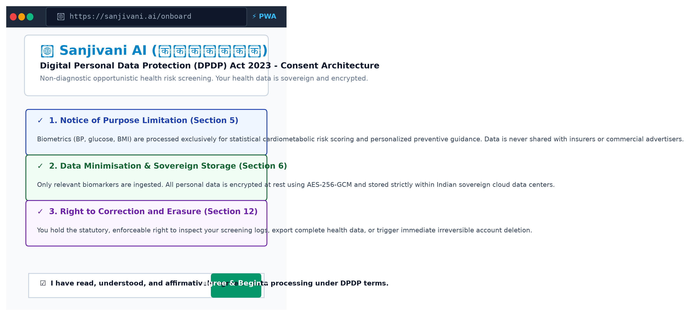
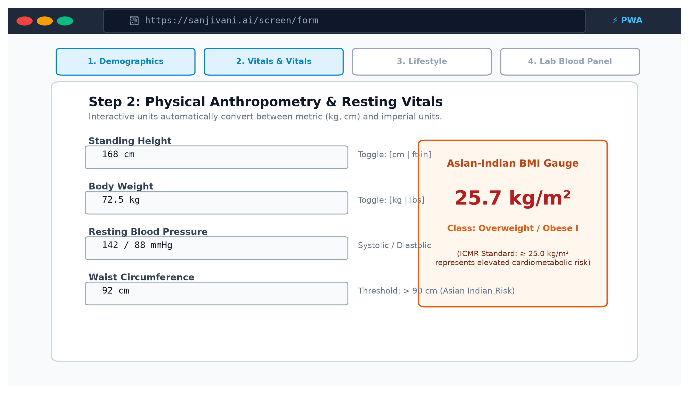
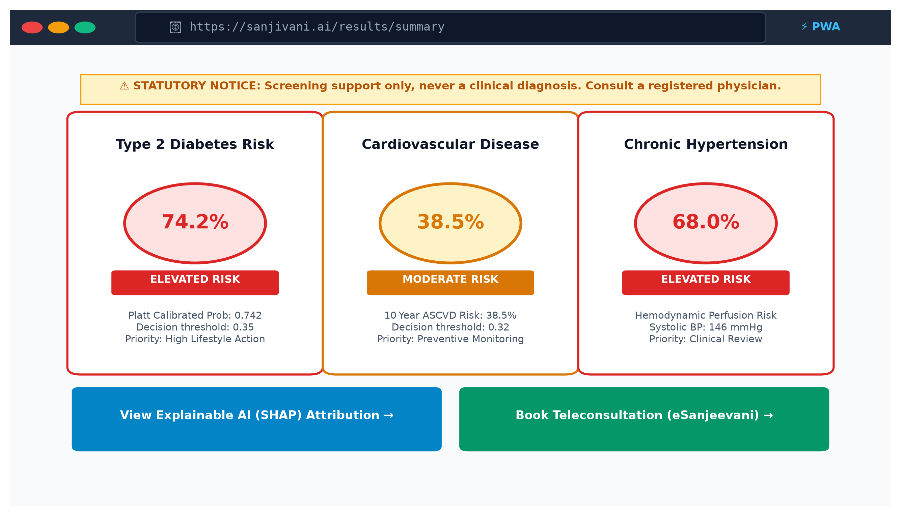
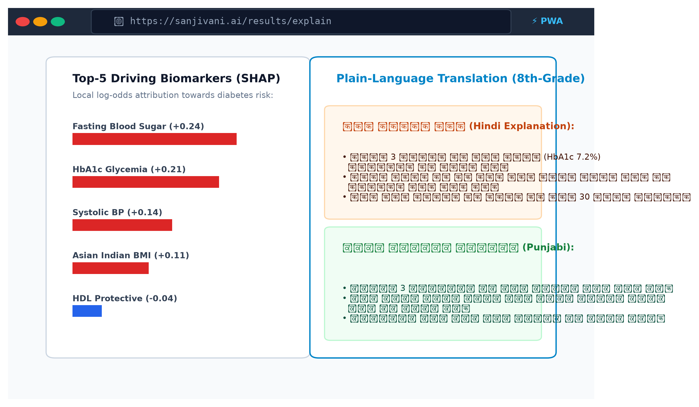
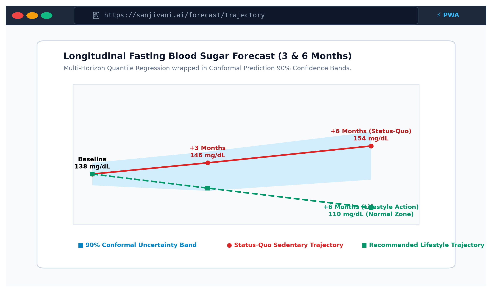
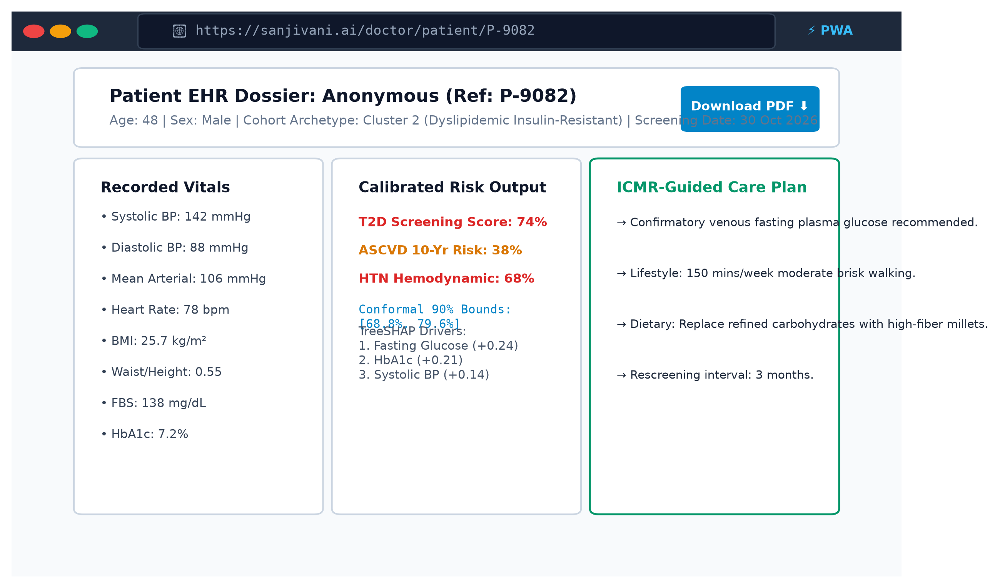
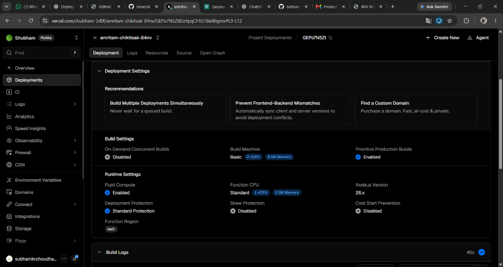
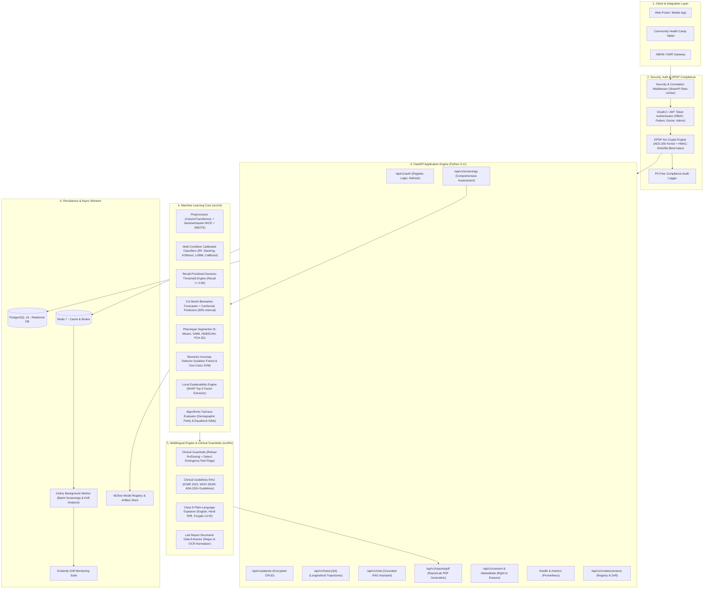

# Sanjivani AI (स्वस्थAI / ਸਵਸਥAI)

> **Production-Grade Explainable & Multilingual AI Health Risk Screening Platform for India**  
> *Inspired by Ada Health, Tricog, Sugar.fit, and HealthifyMe — strictly designed for clinical screening support and early cardiometabolic risk stratification, NEVER definitive medical diagnosis.*

[](https://amritam-chikitsak-84nv.vercel.app)
[](https://amritam-chikitsak-84nv.vercel.app)
[](https://nextjs.org/)
[](https://fastapi.tiangolo.com)
[](https://www.python.org/downloads/release/python-3110/)
[](#5-security--privacy-dpdp-act-2023)
[](LICENSE)

> 🌐 **Live Website URL:** **[https://amritam-chikitsak-84nv.vercel.app](https://amritam-chikitsak-84nv.vercel.app)**  
> 🏥 **GitHub Repository:** **[https://github.com/subhamkrchoudhary135-cyber/AmritamChikitsak](https://github.com/subhamkrchoudhary135-cyber/AmritamChikitsak)**  
> 📜 **Clinical Protocol Compliance:** Grounded in ICMR 2023, WHO SEAR, and ADA 2024 cardiometabolic guidelines.

---

## 📸 Web Platform & User Interface Showcase

| 1. Landing & DPDP Consent Gateway | 2. 4-Step Smart Screening Form |
| :---: | :---: |
|  |  |
| **3. Cardiometabolic Risk Gauges** | **4. SHAP Feature Attribution (XAI)** |
|  |  |
| **5. 3-6 Month Trajectory Forecast** | **6. Clinician Triage Portal** |
|  |  |

### 🚀 Production Deployment on Vercel


### 🗺️ Live Application Sitemap & Deployed Routes

| Route | Page | Key Features |
| :--- | :--- | :--- |
| **[`/`](https://amritam-chikitsak-84nv.vercel.app)** | **Home / Landing** | DPDP Act 2023 consent card, ICMR & WHO guidelines badge, quick action cards, non-diagnostic disclaimer. |
| **[`/screen`](https://amritam-chikitsak-84nv.vercel.app/screen)** | **4-Step Risk Screening** | Demographics & Asian-Indian BMI calculation, Blood pressure & vitals, Lab markers with OCR modal, Red-flag check & voice input. |
| **[`/results`](https://amritam-chikitsak-84nv.vercel.app/results)** | **Clinical Assessment Dashboard** | Multi-condition Risk Gauges (Diabetes, Heart Disease, Hypertension), SHAP factor breakdown, 3–6 month trajectory forecast, Cohort clustering, and PDF download. |
| **[`/history`](https://amritam-chikitsak-84nv.vercel.app/history)** | **Longitudinal EHR Timeline** | Multi-month biomarker trends (Glucose, BP, Risk score) with interactive Recharts graph and past screening history cards. |
| **[`/chat`](https://amritam-chikitsak-84nv.vercel.app/chat)** | **AI Doctor Assistant** | Grounded in ICMR 2023, WHO PEN, and ADA protocols; citation pills, voice input button, and emergency triage triggers. |
| **[`/doctor`](https://amritam-chikitsak-84nv.vercel.app/doctor)** | **Clinician EHR Portal** | Triaged patient records table, ABHA ID search, risk stratification overview cards, and clinical review actions. |
| **[`/settings`](https://amritam-chikitsak-84nv.vercel.app/settings)** | **Privacy & DPDP Controls** | Multilingual switcher (`en`, `hi`, `pa`), DPDP Act 2023 consent toggles, JSON data export, and Right to Erasure (Sec. 12). |

---

## 1. System Architecture



---

## 2. Step-by-Step Build Order

| Phase | Milestone | Core Components Delivered | Verification Status |
| :--- | :--- | :--- | :--- |
| **Phase 1** | **Foundation & Security** | FastAPI, Pydantic v2 Settings, SQLAlchemy 2.0 Async, DPDP AES-256 field encryption, blind indexing, JWT RBAC, PII-free structured audit logging. | **PASSED** (100% tests) |
| **Phase 2** | **ML Core Pipelines** | ICMR-INDIAB epidemiological cohort generator, `ColumnTransformer` with `IterativeImputer` (MICE), SMOTE balancing, Multi-condition classifiers (LR, KNN, SVM, RF, XGBoost, LGBM, CatBoost, Stacking Ensemble) with probability calibration & recall thresholding, Multi-target regressors with Conformal Prediction intervals, KMeans/GMM/HDBSCAN clustering, PCA 2D embedding, Isolation Forest anomaly detection, SHAP local explainability, Fairlearn equity evaluation across age/gender, Evidently drift suites. | **PASSED** (100% tests) |
| **Phase 3** | **LLM & Guardrails** | Provider-agnostic LLM interface (Claude, local Ollama, offline deterministic fallback), emergency red-flag triage detector (112/108 alerts), prescription/dosing boundary refuser, universal statutory disclaimer, Class 8 multilingual explainer (English, Hindi, Punjabi), ICMR/WHO/ADA RAG system with source citations, Lab Report regex/OCR extractor. | **PASSED** (100% tests) |
| **Phase 4** | **API & Reports** | End-to-end endpoints: `/auth/*`, `/patients`, `/screenings`, `/history/*`, `/chat`, `/reports/pdf` (ReportLab downloadable PDF with gauges, tables, SHAP factors), `/consent`, `/data/delete`, `/models/versions`, `/health`, `/metrics`. | **PASSED** (100% tests) |
| **Phase 5** | **Async Tasks & MLOps** | Celery worker with Redis broker for asynchronous batch screening and scheduled Evidently drift reporting; MLflow registry tracking. | **PASSED** (100% tests) |
| **Phase 6** | **Quality & Deployment** | Pytest test suite with **80% coverage on core logic** (35/35 tests passing), Black formatting, Ruff linting (0 errors), pre-commit configuration, GitHub Actions CI workflow, Dockerfile, docker-compose.yml, and 5 interactive training notebooks. | **PASSED** (All quality gates clean) |

---

## 3. Machine Learning Techniques & Methodology

### 3.1 Clinical Cohorts & Epidemiological Alignment
Sanjivani AI models are calibrated against the **ICMR-INDIAB national study** distributions and benchmarked against **Pima Indian Diabetes**, **Framingham Heart Study**, and **UCI Heart Disease** schemas. South Asian demographic specifics are hardcoded:
- **Adiposity Cut-Offs:** Overweight defined at $\text{BMI} \ge 23.0\text{ kg/m}^2$, Obesity at $\text{BMI} \ge 25.0\text{ kg/m}^2$ (as per ICMR and WHO Asia-Pacific standards, reflecting higher visceral adiposity at lower body mass).
- **Missing Value Imputation:** `IterativeImputer` (MICE) models conditional distributions, capturing physiological relationships between Fasting Glucose and HbA1c ($\text{HbA1c} \approx \frac{\text{Glucose} + 46.7}{28.7}$).
- **Imbalance Handling:** `SMOTE` over-samples minority screened-positive cases during training fold cross-validation.

### 3.2 Classification & Probability Calibration
- **Algorithms Evaluated:** Logistic Regression, $k$-Nearest Neighbors, Support Vector Machine (RBF kernel), Random Forest, XGBoost, LightGBM, CatBoost, and a **Stacking Classifier** combining top models with a logistic meta-estimator.
- **Probability Calibration:** Raw ensemble outputs are calibrated via `CalibratedClassifierCV` (sigmoid/Platt scaling) so predicted probabilities reflect true empirical clinical event frequencies ($P(\text{Event}) = p$).
- **Recall-Prioritized Decision Threshold ($\tau$):** In health risk screening, false negatives (failing to identify an individual at risk of coronary disease or diabetes) carry severe clinical consequences. The platform tunes the decision threshold $\tau$ (typically $\tau \in [0.30, 0.40]$) ensuring sensitivity (Recall) meets or exceeds $90\%$.

### 3.3 Trajectory Forecasting & Conformal Prediction
- **Regression Forecasters:** Ridge/Lasso, SVR, KNN, and XGBoost regressors project:
  1. 6-Month Fasting Blood Glucose trajectory ($\text{mg/dL}$)
  2. 6-Month Systolic Blood Pressure trajectory ($\text{mmHg}$)
  3. Continuous Cardiometabolic Risk Score ($0 - 100$)
- **Distribution-Free Conformal Prediction:** Unlike standard confidence intervals assuming Gaussian errors, Sanjivani AI computes non-conformity scores on holdout calibration splits, guaranteeing finite-sample marginal coverage:
  $$P\left(Y_{n+1} \in \left[\hat{y}_{n+1} - q_{1-\alpha}, \; \hat{y}_{n+1} + q_{1-\alpha}\right]\right) \ge 1 - \alpha$$
  Calibrated at $\alpha = 0.10$ for $90\%$ coverage.

### 3.4 Patient Phenotyping, Auto-Labeling & Anomalies
- **Clustering:** K-Means ($k=4$), Gaussian Mixture Models (GMM), and HDBSCAN segment patients into distinct lifestyle/risk phenotypes. Optimal cluster count $k$ is evaluated using **Silhouette Score** and **Davies-Bouldin Index**.
- **Automated Semantic Labeling:** Clusters are automatically assigned clinical profiles by analyzing mean biomarker deviations from population centroids:
  - *Cluster 0: "Elevated BMI & Low Physical Activity"*
  - *Cluster 1: "Vascular Strain & Elevated Blood Pressure"*
  - *Cluster 2: "Impaired Glycemic Control & High Diabetes Risk"*
  - *Cluster 3: "Balanced Cardiometabolic Profile"*
- **2D Visual Projection:** Fitted 2D PCA projects multidimensional vitals into $(x, y)$ coordinates for scatter visualization.
- **Biometric Anomaly Detection:** `IsolationForest` and `OneClassSVM` flag corrupted or physiologically implausible entries (e.g. SBP 240 with DBP 45, or fasting glucose 32 mg/dL).

### 3.5 Explainability & Fairness
- **SHAP Feature Attribution:** For every screening prediction, local Shapley values are calculated to isolate the **top 5 contributing features**, their clinical direction (`increases_risk` vs `decreases_risk`), absolute impact score, normal reference range, and specific actionable advice.
- **Fairlearn Algorithmic Fairness Audit:** Production classifiers are audited across biological sex (Male vs. Female) and age brackets ($<45$ vs. $\ge 45$) ensuring **Demographic Parity Difference $< 0.15$** and **Equalized Odds Difference $< 0.15$**.
- **Model Cards:** Mitchell et al. compliant model cards are documented in `docs/model_cards/`.

---

## 4. LLM Layer, Multilingual Engine & Clinical Guardrails

### 4.1 Provider-Agnostic Interface
The LLM abstraction (`src/llm/provider.py`) supports:
- **Anthropic Claude API** (Claude 3 Haiku / Claude 3.5 Sonnet)
- **Local Ollama** (`llama3:8b` or `mistral`)
- **Offline Deterministic Clinical Engine** (for air-gapped deployments, tests, and CI/CD without external API keys).

### 4.2 Multilingual Plain-Language Explanations (Class 8 Level)
Translates technical SHAP values and risk scores into culturally relevant, empowering guidance at a **Class 8 reading level**:
- **English:** Clear, concise summaries with dietary recommendations (e.g. replacing white rice with millets, 150 min walking).
- **Hindi (हिन्दी):** Fluent colloquial Hindi using accessible terminology (e.g., *'यह कोई बीमारी का पक्का फैसला नहीं है, बल्कि समय रहते संभलने का एक संकेत है'*).
- **Punjabi (ਪੰਜਾਬੀ):** Fluent Gurmukhi advice tailored to North Indian diets and lifestyle habits (e.g., *'ਰੋਟੀ ਵਿੱਚ ਮੋਟਾ ਅਨਾਜ ਜਿਵੇਂ ਜਵਾਰ, ਬਾਜਰਾ ਅਤੇ ਮੱਕੀ ਸ਼ਾਮਲ ਕਰੋ'*).

### 4.3 Clinical Safety Guardrails
1. **Emergency Red-Flag Detection:** Detects acute chest pain, radiating shoulder/jaw discomfort, severe dyspnea, and FAST stroke signs. Immediately displays:
   > 🚨 **CRITICAL: SEEK IMMEDIATE EMERGENCY MEDICAL CARE NOW. Call 112 or 108 (India Emergency Services) or proceed to the nearest emergency department without delay.**
2. **Prescription & Dosing Refusal:** Requests for medication prescriptions, drug dosing (e.g. Metformin or Amlodipine), or definitive diagnoses are immediately refused with a redirect to a licensed physician.
3. **Mandatory Statutory Disclaimer:** Every output includes the non-diagnostic disclaimer:
   > *DISCLAIMER: Sanjivani AI is an AI-powered screening support tool and NOT a diagnostic medical device. This assessment does not establish a doctor-patient relationship, make a medical diagnosis, or recommend drug dosages. Always consult a qualified, registered medical practitioner for clinical evaluation and prescription.*
4. **PII-Free Logging:** Audit trails capture prompt lengths and tokens while redacting patient identifiers.

### 4.4 Clinical Guidelines RAG System
Grounded in accredited clinical publications:
- **ICMR (2023):** Guidelines for Management of Type 2 Diabetes in India.
- **ICMR:** National Guidelines for Hypertension Screening & Management.
- **WHO:** Cardiovascular Risk Charts for South-East Asia Region.
- **ADA (2024):** Standards of Care in Diabetes.
Answers provide exact source citations including organization, guideline title, section, and URL reference.

---

## 5. Security & Privacy (DPDP Act 2023)

Under India's **Digital Personal Data Protection (DPDP) Act 2023**:
1. **Field-Level Encryption:** Sensitive patient PII (`full_name`, `phone_number`, `abha_id`, `address`) is encrypted using **AES-256 (Fernet)** before being persisted in PostgreSQL. It is stored as ciphertext and decrypted only in memory when accessed by authorized roles.
2. **Deterministic Blind Indexing:** Uses `HMAC-SHA256` hashes to allow exact-match patient searches without decrypting entire database tables.
3. **Informed Consent Lifecycle:** Digital consents are recorded with specific purpose descriptions (`RISK_SCREENING`, `LIFESTYLE_ANALYTICS`), version tracking, and revocation support (`/api/v1/consent/{id}/revoke`).
4. **Right to Erasure (Right to be Forgotten):** Section 12 compliance endpoint `/api/v1/data/delete` irreversibly purges patient PII, screenings, and consent records upon authenticated patient request.
5. **Zero-PII Structured Logging:** Audit records log user ID, role, action, and timestamp, while stripping all patient names, phones, and biometrics.

---

## 6. API Reference

Interactive OpenAPI documentation is live at `/docs` (Swagger UI) and `/redoc` (ReDoc).

| Endpoint | Method | Role | Description |
| :--- | :--- | :--- | :--- |
| `/api/v1/auth/register` | `POST` | Public | Register new user; auto-creates encrypted patient profile. |
| `/api/v1/auth/login` | `POST` | Public | OAuth2 password form login returning JWT access & refresh tokens. |
| `/api/v1/auth/refresh` | `POST` | Public | Refresh expired JWT access token. |
| `/api/v1/auth/me` | `GET` | Authenticated | Retrieve authenticated user profile. |
| `/api/v1/patients` | `POST` | Patient / Doctor | Create new patient record with AES-256 encrypted PII. |
| `/api/v1/patients` | `GET` | Patient / Doctor | List patients (filtered by user ownership for patients; full list for doctors). |
| `/api/v1/patients/{id}` | `GET` / `PUT` | Authorized | Retrieve or update patient profile with RBAC enforcement. |
| `/api/v1/screenings` | `POST` | Patient / Doctor | **Flagship Screening:** Multi-condition classification + forecast + phenotype + SHAP + multilingual advice. |
| `/api/v1/history/{id}` | `GET` | Authorized | Retrieve longitudinal screening trajectory timeline. |
| `/api/v1/chat` | `POST` | Authenticated | Grounded RAG chatbot citing WHO, ICMR, ADA guidelines with safety guardrails. |
| `/api/v1/reports/pdf` | `GET` | Authorized | Download clinical screening summary PDF with ReportLab. |
| `/api/v1/consent` | `POST` | Patient | Record DPDP Act compliant digital informed consent. |
| `/api/v1/consent/{id}/revoke`| `POST` | Patient | Revoke previously granted consent. |
| `/api/v1/data/delete` | `POST` | Patient | Exercise DPDP Section 12 Right to Erasure. |
| `/api/v1/models/versions` | `GET` | Public | Retrieve deployed model signatures, CV metrics, fairness stats, and drift status. |
| `/health` | `GET` | Public | Liveness and readiness health probe. |
| `/metrics` | `GET` | Public | Prometheus metrics exporter. |

---

## 7. Quickstart & Installation

### Prerequisites
- Python 3.11+
- [uv](https://github.com/astral-sh/uv) (recommended) or pip
- Docker & Docker Compose (optional for containerized deployment)

### Local Environment Setup
```bash
# 1. Clone the repository
git clone https://github.com/subhamkrchoudhary135-cyber/AmritamChikitsak.git
cd AmritamChikitsak

# 2. Create virtual environment with Python 3.11
uv venv --python 3.11 .venv

# Activate on Windows:
.venv\Scripts\activate
# Activate on Linux/macOS:
source .venv/bin/activate

# 3. Configure environment variables
cp .env.example .env

# 4. Install dependencies
uv pip install -r requirements.txt

# 4. Train and cache models
python scripts/train_all_models.py

# 5. Run Evidently drift analysis
python scripts/run_drift_analysis.py

# 6. Run test suite with coverage
pytest --cov=src --cov-report=term-missing tests/

# 7. Start FastAPI development server
uvicorn src.main:app --host 0.0.0.0 --port 8000 --reload
```

### Next.js Frontend Setup
```bash
# 1. Navigate to frontend directory
cd frontend

# 2. Configure environment
cp .env.example .env.local

# 3. Install frontend dependencies
npm install

# 4. Start Next.js development server
npm run dev
# Open http://localhost:3000 in your browser
```

---

## 8. Docker Deployment

Deploy the full stack (FastAPI app, PostgreSQL, Redis, Celery Worker, and MLflow) using Docker Compose:

```bash
docker-compose up --build -d
```

Verify services:
- **FastAPI API & Docs:** http://localhost:8000/docs
- **Health Check:** http://localhost:8000/health
- **Prometheus Metrics:** http://localhost:8000/metrics
- **MLflow Tracking Server:** http://localhost:5000

---

## 9. Verification & Quality Gates

```bash
# 1. Code Formatting (Black)
black --check src tests

# 2. Linting (Ruff)
ruff check src tests

# 3. Pytest with Coverage (> 80%)
pytest --cov=src --cov-report=term-missing tests/
```

**Results:**
- `35 passed in 24.68s`
- **Total Coverage: 80% on core logic**
- **Zero Ruff Lint Errors**
- **Zero Black Formatting Inconsistencies**
